# GAN Paper Re-implementation: *Generative Adversarial Nets* (Goodfellow et al., 2014)

A from-scratch PyTorch re-implementation of the original GAN framework, together with a controlled 2-D mode-collapse study, a reduced-scale MNIST experiment, ablation studies and an IEEE-style report.

> **Honest summary of the outcome**
> * The core algorithm (minimax and non-saturating losses, MLP generator, maxout discriminator with dropout, Parzen-window evaluation) is implemented and works as expected on a **2-D Gaussian-mixture testbed**, including the "Helvetica scenario" warning from the paper.
> * The **MNIST reproduction of the paper's Table 1 failed**: in my runs the generator collapsed to a single output (Parzen log-likelihood **−321** vs. the paper's **+225**). I report this as a failed reproduction, not a success. Diagnostics and a preliminary (single-seed) ablation are included.

---

## Table of contents

1. [Project overview](#1-project-overview)
2. [Original paper](#2-original-paper)
3. [Research objectives](#3-research-objectives)
4. [GAN in a nutshell](#4-gan-in-a-nutshell)
5. [Architecture](#5-architecture)
6. [Technologies and libraries](#6-technologies-and-libraries)
7. [Experimental setup](#7-experimental-setup)
8. [2-D Gaussian-mixture experiments](#8-2-d-gaussian-mixture-experiments)
9. [MNIST experiments](#9-mnist-experiments)
10. [Ablation studies](#10-ablation-studies)
11. [Summary of findings](#11-summary-of-findings)
12. [Repository structure](#12-repository-structure)
13. [Installation](#13-installation)
14. [Running the notebook](#14-running-the-notebook)
15. [Limitations and future work](#15-limitations-and-future-work)
16. [License and attribution](#16-license-and-attribution)
17. [Author](#17-author)

---

## 1. Project overview

Generative Adversarial Networks (GANs) train a **generator** `G` against a **discriminator** `D`: `D` learns to tell real data from generated data, while `G` learns to produce samples that fool `D`. This project re-implements that framework from scratch (no third-party GAN code) and tests it at reduced scale.

What is in this repository:

| Part | Description |
|---|---|
| **Implementation** | One config-driven training loop (`Cfg`, `build_G`, `build_D`, `Maxout`, loss functions) used for every experiment, so each ablation changes exactly one field. |
| **Toy 2-D testbed** | Two Gaussian mixtures with known modes (`ring8`, `grid25`) that make mode collapse *measurable*. *(My own addition — not an experiment from the paper.)* |
| **MNIST experiment** | MLP generator + maxout discriminator, evaluated with the paper's Parzen-window log-likelihood plus a classifier-based collapse diagnostic. |
| **Ablations** | Toy: update ratio, capacity, noise dimension, batch size, Adam β₁, learning rate, depth. MNIST: loss, dropout, activation, update ratio, noise dimension, generator width, Adam β₁. |
| **Report** | An IEEE-style report (LaTeX source and compiled PDF) in [`report/`](report/). |

## 2. Original paper

> Ian J. Goodfellow, Jean Pouget-Abadie, Mehdi Mirza, Bing Xu, David Warde-Farley, Sherjil Ozair, Aaron Courville, Yoshua Bengio.
> **Generative Adversarial Nets.** *Advances in Neural Information Processing Systems 27 (NIPS 2014).*
> arXiv: [1406.2661](https://arxiv.org/abs/1406.2661)

The paper itself is **not** redistributed in this repository; please read it at the arXiv link above. All credit for the GAN framework belongs to the original authors. This repository is an independent, educational re-implementation.

## 3. Research objectives

1. Implement the core GAN algorithm from scratch in PyTorch.
2. Reproduce a key result of the paper at reduced scale (the MNIST column of the paper's Table 1).
3. Study *what matters* through controlled ablations, and make mode collapse measurable on a toy problem.
4. Report results exactly as measured, including failures.

## 4. GAN in a nutshell

Let `z ~ p_z` be noise and `G(z)` a generated sample. `D(x)` is the probability that `x` is real. The two networks play the minimax game from the paper:

```
min_G max_D  V(D, G) = E_{x~p_data}[ log D(x) ] + E_{z~p_z}[ log(1 − D(G(z))) ]
```

For a fixed `G` the optimal discriminator is `D*(x) = p_data(x) / (p_data(x) + p_g(x))`, and the global optimum is `p_g = p_data` (where `D* = 1/2` everywhere).

**Losses implemented** (all written on logits `a` with `softplus` for numerical stability; `D(x) = sigmoid(a(x))`):

| Loss | Formula (minimised) | Notes |
|---|---|---|
| Discriminator | `E[softplus(−a(x))] + E[softplus(a(G(z)))]` | Binary cross-entropy on real vs. generated samples |
| Generator, **minimax** | `−E[softplus(a(G(z)))]`, i.e. `log(1 − D(G(z)))` | Saturates when `D(G(z)) ≈ 0`: gradient magnitude is `D(G(z))` |
| Generator, **non-saturating** | `E[softplus(−a(G(z)))]`, i.e. `−log D(G(z))` | The paper's practical trick: gradient magnitude is `1 − D(G(z))` |

Each training iteration performs `k` discriminator steps (`k = 1` unless stated) followed by one generator step on fresh noise.

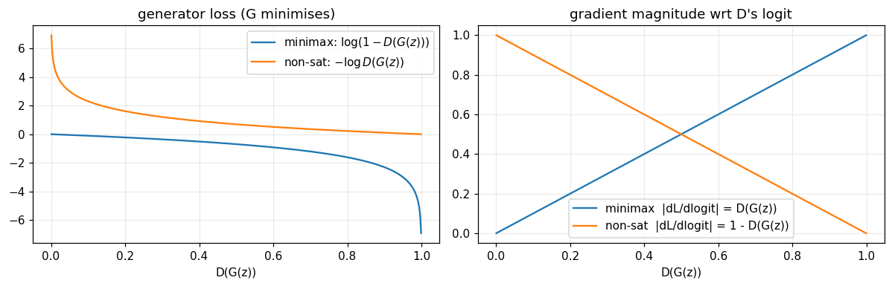
*Generator losses (left) and their gradient magnitude w.r.t. D's logit (right). The minimax gradient vanishes exactly where G is weakest.*

## 5. Architecture

All dimensions below were checked against the notebook code (`Cfg`, `build_G`, `build_D`, `Maxout`, `mnist_cfg`). Parameter counts are computed from those layer definitions.

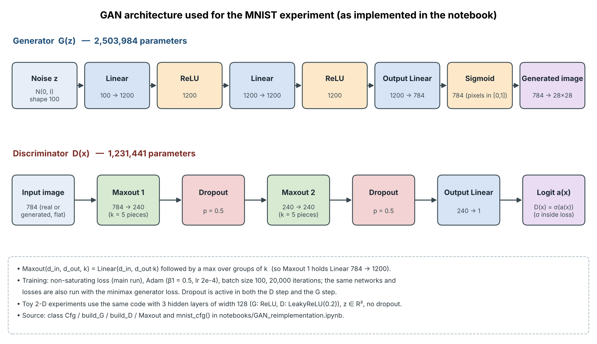

### Generator (MNIST configuration) — 2,503,984 parameters

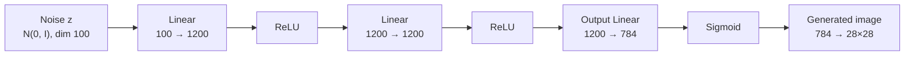

### Discriminator (MNIST configuration) — 1,231,441 parameters

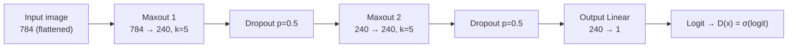

Notes on how the code differs from a simplified schematic:

* **No explicit Flatten layer.** MNIST images are flattened to 784-d vectors once when the data is loaded.
* **Dropout follows *each* maxout layer** (two dropout layers, `p = 0.5`), and it stays active in both the discriminator step and the generator step.
* `Maxout(d_in, d_out, k)` is implemented as `Linear(d_in, d_out·k)` followed by a max over groups of `k` (so Maxout 1 holds a `784 → 1200` linear map).
* The discriminator outputs a **logit**; the sigmoid is applied inside the loss functions.
* The **toy 2-D experiments** use the same code with 3 hidden layers of width 128 (G: ReLU; D: LeakyReLU(0.2)), `z ∈ ℝ²`, no dropout.

**Original paper vs. this implementation:** the paper uses rectifier (and sigmoid) generator units and a maxout discriminator trained with dropout, with noise fed only to the bottom layer of the generator. This implementation follows that design in spirit but is **not** an exact replica (see [deviations](#deviations-from-the-paper)).

## 6. Technologies and libraries

| Library | Used for |
|---|---|
| **PyTorch** | Models, losses, training loop |
| **torchvision** | MNIST download/loading |
| **NumPy / pandas** | Metrics, result tables |
| **Matplotlib** | All plots and figures |
| **Jupyter / IPython** | Notebook environment |
| **LaTeX (IEEEtran)** | Report (`report/main.tex`) |

The exact dependency list (derived from the notebook's imports) is in [`requirements.txt`](requirements.txt).

## 7. Experimental setup

| Setting | Toy 2-D | MNIST |
|---|---|---|
| Data | `ring8` (8 modes, radius 2) and `grid25` (5×5, spacing 2); component σ = 0.05 | MNIST, 50k / 10k / 10k train / validation / test, pixels in [0, 1], 784-d |
| Noise dim `z` | 2 | 100 |
| Generator | 3 hidden layers × 128, ReLU | 2 hidden layers × 1200, ReLU, sigmoid output |
| Discriminator | 3 hidden layers × 128, LeakyReLU(0.2), no dropout | 2 maxout layers (240 units, 5 pieces), dropout 0.5 |
| Optimiser | Adam (β₁ = 0.5), lr 5e-4 | Adam (β₁ = 0.5), lr 2e-4 |
| Batch size | 256 | 100 |
| Iterations | 5,000 | 20,000 (main run); 8,000 (ablations) |
| Seeds | 3 (main comparison), 2 (ablations) | 1 (seed 0) |
| Hardware | Google Colab, T4 GPU | Google Colab, T4 GPU |

**Metrics**

* *Toy:* **modes covered** (modes receiving ≥ 10 % of their fair share of high-quality samples), **hq** (fraction of samples within 4σ of a mode) and **JS** (normalised Jensen–Shannon divergence between the distribution of high-quality samples over modes and uniform; 0 = balanced, 1 = worst). Thresholds are my own choices.
* *MNIST, Parzen log-likelihood (the paper's metric):* Gaussian KDE fitted on 10,000 generated samples, bandwidth chosen on the validation set from a 10-point log grid on [0.1, 1], mean test log-likelihood reported with its standard error. The paper itself notes this estimator has high variance and degrades in high dimensions.
* *MNIST, collapse diagnostics (my addition):* a small CNN trained on real MNIST (98.6 % test accuracy) gives the class histogram of generated digits, a normalised class entropy (1 = all classes equally frequent) and an Inception-style score `exp(E KL(p(y|x) ‖ p(y)))` (max 10). On real test data these are 9.49 and 0.999.

### Deviations from the paper

* Adam instead of SGD with momentum.
* Shorter training (20k iterations); single seed for the main MNIST run.
* DBN / stacked CAE / deep GSN baselines are **quoted from the paper**, not re-trained.
* No TFD or CIFAR-10 experiments.
* Parzen bandwidth from a 10-value grid; Parzen estimate computed on 10k generated samples.

Because of these differences, exact numerical agreement with the paper was not expected.

## 8. 2-D Gaussian-mixture experiments

### Main comparison (minimax vs. non-saturating)

Mean ± std over 3 seeds, 5,000 iterations:

| Data | G loss | Modes covered | hq | JS |
|---|---|---|---|---|
| ring8 | minimax | 8.0 ± 0.0 | 0.949 ± 0.006 | 0.001 ± 0.000 |
| ring8 | non-saturating | 7.7 ± 0.6 | 0.960 ± 0.005 | 0.032 ± 0.049 |
| grid25 | minimax | 20.3 ± 3.2 | 0.453 ± 0.102 | 0.150 ± 0.074 |
| grid25 | non-saturating | 17.7 ± 2.5 | 0.551 ± 0.132 | 0.203 ± 0.051 |

* `ring8` is solved by both losses. On the harder `grid25`, neither loss covers all 25 modes, and the difference between the losses is **smaller than the seed-to-seed spread**, so I do not claim either loss is better here.
* Mean `D(G(z))` stayed roughly between 0.2 and 0.5 throughout toy training (figure below), so the saturating regime of the minimax loss was probably never reached; this is a plausible explanation consistent with the diagnostics, not a proven one.

| | |
|---|---|
| 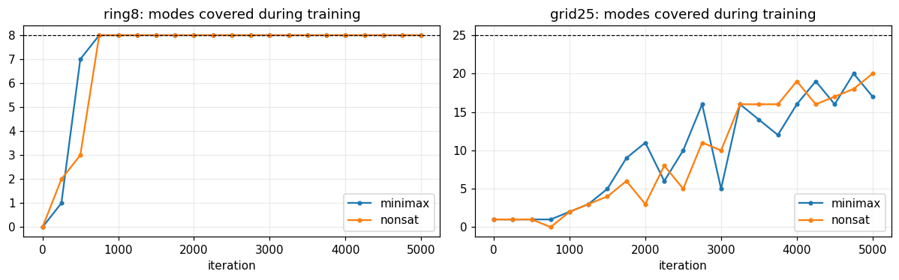 | 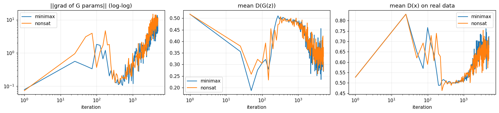 |
| *Modes covered during training (seed 0).* | *`grid25` diagnostics: G gradient norm, mean D(G(z)), mean D(x).* |

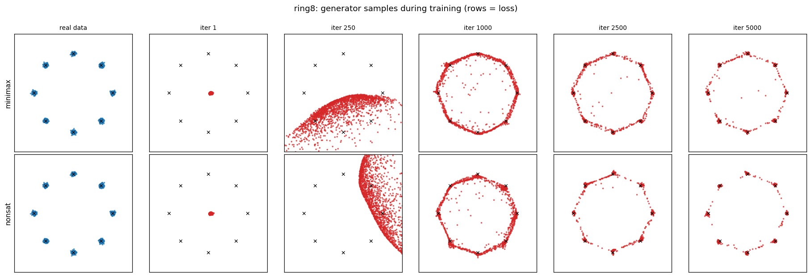
*`ring8`: generator samples during training (seed 0; top row minimax, bottom row non-saturating).*

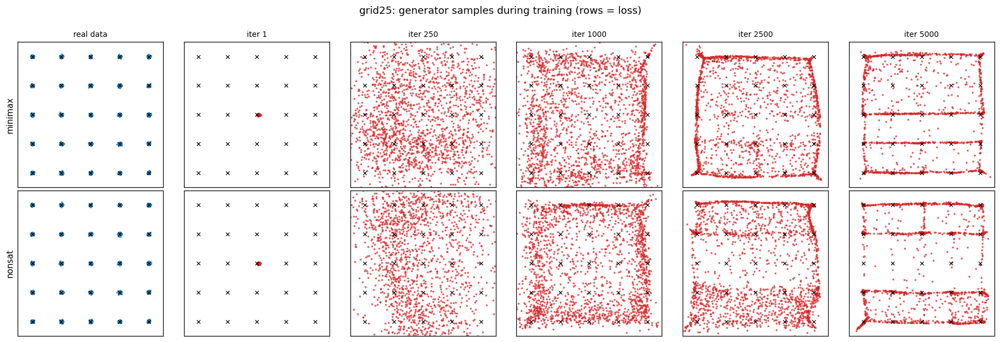
*`grid25`: generator samples during training (seed 0). At 5,000 iterations many samples lie on lines between modes rather than on the modes, which explains the low hq in the table.*

### The "Helvetica scenario" (update-ratio experiment)

The paper warns that `G` must not be trained too much without updating `D`. On `ring8` (seed 0, non-saturating loss):

| D : G steps | Modes covered | hq | JS |
|---|---|---|---|
| 1 : 1 (base) | 8 / 8 | 0.96 | 0.002 |
| 1 : 5 (G-heavy) | **0 / 8** | 0.00 | 1.000 |
| 5 : 1 (D-heavy) | 2 / 8 | 0.93 | 0.495 |

The G-heavy run collapses to a point that hops between modes, matching the paper's description. The D-heavy run traces the circle but does not settle on the modes. This is a single seed for `ring8`; a larger `grid25` ablation with 2 seeds (below) shows the same G-heavy collapse.

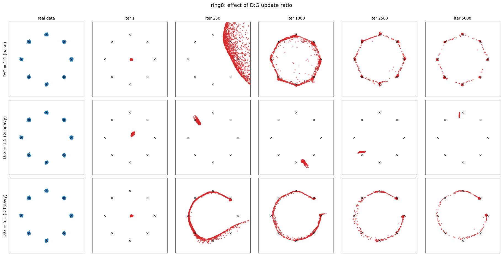

## 9. MNIST experiments

### Result vs. the paper's Table 1 (higher is better)

Top: values **quoted from the paper's Table 1** (Parzen-window log-likelihood on the MNIST test set). Bottom: **my measurements** (seed 0, 20k iterations).

| Model | Parzen log-lik. | Inception-style score (max 10) | Class entropy |
|---|---|---|---|
| DBN *(paper)* | 138 ± 2 | – | – |
| Stacked CAE *(paper)* | 121 ± 1.6 | – | – |
| Deep GSN *(paper)* | 214 ± 1.1 | – | – |
| Adversarial nets *(paper)* | 225 ± 2 | – | – |
| **GAN, non-saturating (mine)** | **−321.4 ± 1.2** | 1.00 | 0.018 |
| **GAN, minimax (mine)** | **−435.4 ± 0.5** | 1.03 | 0.070 |
| Reference: KDE of 10k real training images | 242.4 ± 2.1 | – | – |
| Reference: untrained generator | −541.3 ± 0.1 | 1.00 | – |

**My GAN did not reproduce the paper's result.** Both generators collapsed: the non-saturating generator outputs essentially the same digit "1" for every noise vector, and the minimax generator outputs a single blob (the classifier's class histogram assigns it almost entirely to one class). The Inception-style score is ≈ 1 and class entropy is near 0.

The two reference rows show that the *estimator* is behaving sensibly (a KDE of real images scores 242, close to the paper's 225, while an untrained generator scores −541), so the problem lies with the trained generator, not with the metric code.

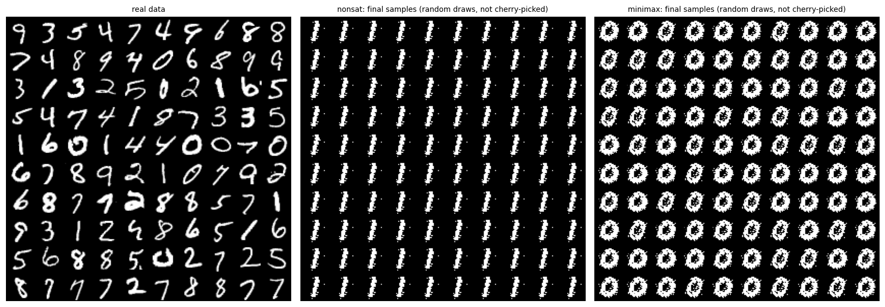
*Real MNIST digits (left) and final samples from my non-saturating (middle) and minimax (right) generators — random draws, not cherry-picked. Both have collapsed.*

### Why did it fail? (observations, not proven causes)

* The discriminator wins decisively: mean `D(G(z))` falls to nearly zero within the first few thousand iterations and D's loss stays near zero.
* For the minimax loss the generator's gradient norm decays by orders of magnitude, as the saturation argument predicts.
* The non-saturating loss keeps a large gradient and **still** collapses, so avoiding saturation alone was not sufficient in this setup.
* I did not find a coding error in the losses, but I cannot rule out that my optimiser and capacity choices make D too strong. The base configuration was not tuned on the validation set.

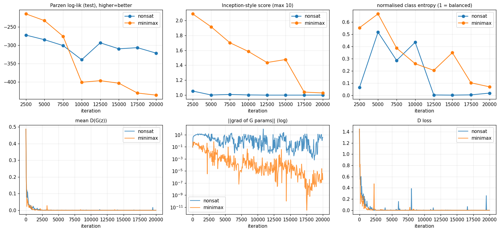
*Top: Parzen log-likelihood, Inception-style score, class entropy at 8 checkpoints. Bottom: mean D(G(z)), generator gradient norm, discriminator loss.*

| | |
|---|---|
|  | 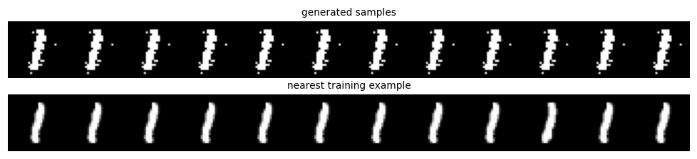 |
| *Class histogram of generated digits (dashed = uniform): each generator produces essentially one class.* | *Generated samples (top) and nearest training images (bottom), analogue of Fig. 2 in the paper. Median NN distance: 4.59 generated vs. 4.43 held-out test. Since every sample is the same digit, this check says little about memorisation.* |

Training snapshots (iterations 2,500 → 20,000) and a latent-space interpolation are also kept for completeness: [`training_snapshots_nonsat.png`](results/mnist/training_snapshots_nonsat.png), [`training_snapshots_minimax.png`](results/mnist/training_snapshots_minimax.png), [`zspace_interpolation.png`](results/mnist/zspace_interpolation.png) (uninformative here, since the generator has collapsed).

## 10. Ablation studies

### Hypotheses

* **H1 (loss):** the non-saturating loss should give G a useful gradient where minimax saturates, so I expected it to cover more modes / score higher.
* **H2 (update ratio):** a G-heavy update ratio should collapse G (the "Helvetica scenario").

### Toy ablations (`grid25`, 2 seeds, 5,000 iterations)

Mean number of modes covered (out of 25). One factor is changed at a time from the base configuration (bold = base). With only 2 seeds, treat differences as real only if they are clearly larger than the error bars shown in the per-factor plots.

| Factor | Setting | Minimax | Non-sat. |
|---|---|---|---|
| D:G steps | **1:1** | 21.5 | 19.0 |
| | 5:1 (D-heavy) | 15.0 | 8.5 |
| | 1:5 (G-heavy) | 0.5 | 1.5 |
| Width (G/D) | 16/16 | 0.5 | 1.0 |
| | 64/64 | 14.5 | 8.0 |
| | **128/128** | 21.5 | 19.0 |
| | 256/256 | 24.5 | 20.5 |
| | G256 / D16 | 0.5 | 0.0 |
| | G16 / D256 | 12.5 | 2.5 |
| Noise dim `z` | 1 | 14.5 | 14.0 |
| | **2** | 21.5 | 19.0 |
| | 16 | 14.5 | 9.0 |
| Batch size | 32 | 11.0 | 13.5 |
| | **256** | 21.5 | 19.0 |
| Adam β₁ | 0.0 | 15.5 | 14.0 |
| | **0.5** | 21.5 | 19.0 |
| | 0.9 | 3.0 | 2.0 |
| Learning rate | 1e-4 | 8.0 | 7.5 |
| | **5e-4** | 21.5 | 19.0 |
| | 2e-3 | 15.0 | 22.5 |
| | D 10× faster | 12.5 | 9.5 |
| | G 10× faster | 2.0 | 1.0 |
| Depth (layers) | 1 | 1.0 | 0.5 |
| | 2 | 12.5 | 12.5 |
| | **3** | 21.5 | 19.0 |

Per-factor bar charts (modes covered, hq, JS, with error bars) are in [`results/gaussian_mixture/ablations/`](results/gaussian_mixture/ablations/).

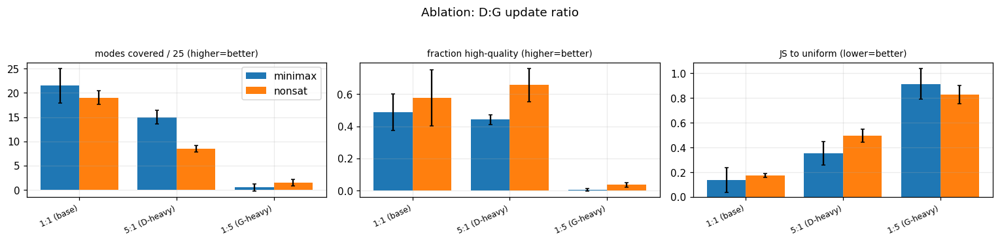
*Example: update-ratio ablation on `grid25` (bars: mean over 2 seeds; error bars: std).*

**Findings (toy):**

* **H2 is supported:** the G-heavy 1:5 ratio collapsed both losses (0.5 and 1.5 modes), as did configurations that make G much stronger than D (G256/D16, G 10× faster) or give Adam a high β₁ = 0.9.
* **H1 is *not* supported on the toy data:** minimax is slightly ahead at the base setting (21.5 vs. 19.0 in the 2-seed ablation; 20.3 ± 3.2 vs. 17.7 ± 2.5 over 3 seeds), within about one standard deviation. With 2–3 seeds I treat this as inconclusive rather than as evidence against the paper.
* Larger / deeper networks generally covered more modes (e.g. 256/256 covered 24.5 and 20.5 on average), while very small networks (16/16, 1 layer) failed. These are single-configuration, 2-seed observations.

### MNIST ablation (preliminary: 8,000 iterations, **one seed**)

One factor at a time from the base configuration (non-saturating, `z = 100`, G width 1200, dropout 0.5, maxout D, D:G = 1:1, Adam β₁ = 0.5).

| Factor | Setting | Parzen log-lik. | Inception-style score | Class entropy |
|---|---|---|---|---|
| – | **base** | −295.1 | 1.00 | 0.004 |
| Loss | minimax | −410.1 | 1.02 | 0.051 |
| D dropout | 0.0 | −445.0 | 1.01 | 0.227 |
| D activation | LeakyReLU | −350.1 | 1.01 | 0.287 |
| D:G steps | 3:1 | −546.9 | 1.00 | 0.005 |
| D:G steps | 1:3 | −331.6 | 1.00 | 0.113 |
| Noise dim `z` | 10 | **+103.9** | 5.87 | 0.894 |
| G width | 512 | −524.3 | 1.00 | 0.059 |
| G width | 128 | −131.1 | 1.94 | 0.466 |
| Adam β₁ | 0.0 | −796.9 | 1.00 | 0.032 |
| Adam β₁ | 0.9 | −682.2 | 1.00 | 0.597 |

Because the base configuration itself is collapsed, these numbers should be read **only as leads**. Two changes stand out: reducing the noise dimension from 100 to 10, and a much narrower generator (128 units). Every other change left the Inception-style score near 1. With a single seed, I cannot say whether these gains are robust, and the +103.9 should **not** be compared with the paper's 225. Plots: [`mnist_ablation_metrics.png`](results/mnist/ablations/mnist_ablation_metrics.png) and [`mnist_ablation_samples.png`](results/mnist/ablations/mnist_ablation_samples.png).


## 11. Summary of findings

| Claim | Evidence | Confidence |
|---|---|---|
| The implementation covers `ring8` and trains stably there | 8.0 ± 0.0 / 7.7 ± 0.6 modes over 3 seeds | Reasonable (3 seeds) |
| A G-heavy update ratio collapses G (paper's "Helvetica scenario") | `ring8` 0/8 modes; `grid25` 0.5 / 1.5 modes | Consistent across both datasets, few seeds |
| Non-saturating loss is better than minimax | Not observed on toy data | Inconclusive |
| MNIST GAN reproduces the paper's Table 1 | **No** — collapse, log-lik. −321 vs. +225 | Clear failure of this reproduction |
| Smaller `z` or narrower G avoids MNIST collapse | One seed, 8k iterations | Preliminary, needs multiple seeds |

## 12. Repository structure

```text
GAN-Paper-Reimplementation/
├── README.md
├── requirements.txt
├── .gitignore
├── notebooks/
│   └── GAN_reimplementation.ipynb      # full implementation, experiments and stored outputs
├── report/
│   ├── suru_paper.pdf                  # compiled report
│   ├── main.tex                        # LaTeX source (IEEEtran)
│   ├── references.bib
│   └── figures/                        # 8 figures used in the report
├── results/
│   ├── gaussian_mixture/
│   │   ├── ring8_snapshots.png
│   │   └── ablations/                  # 7 toy ablation plots
│   └── mnist/
│       ├── class_histogram.png
│       ├── training_snapshots_nonsat.png
│       ├── training_snapshots_minimax.png
│       ├── zspace_interpolation.png
│       └── ablations/                  # MNIST ablation plots
└── assets/
    └── architecture_diagram.png
```

The main toy and MNIST figures used in the report live in `report/figures/`; `results/` contains the additional plots exported from the notebook's stored outputs.

**About the report files.** `suru_paper.pdf` was compiled from an earlier revision of the report (5 pages, 5 figures). `main.tex` is the latest source and additionally includes three figures (modes covered during training, `grid25` snapshots, nearest-neighbour check). Recompiling `main.tex` (see below) gives the latest version.

To compile the report: `cd report && pdflatex main && bibtex main && pdflatex main && pdflatex main` (requires a TeX distribution with the `IEEEtran` class, or upload the `report/` folder to Overleaf).

## 13. Installation

```bash
git clone <your-repository-url>
cd GAN-Paper-Reimplementation

python -m venv .venv
source .venv/bin/activate          # Windows: .venv\Scripts\activate

# Optional but recommended for GPU training: install the CUDA build of PyTorch first,
# following https://pytorch.org/get-started/locally/
pip install -r requirements.txt
```

## 14. Running the notebook

```bash
jupyter notebook notebooks/GAN_reimplementation.ipynb
```

* Run the cells top to bottom. MNIST is downloaded automatically to `notebooks/data/` on first run (ignored by git).
* **`FAST` flag (Section 0):** set `FAST = True` for a quick smoke test (shorter runs, 1,500 toy iterations, 4,000 MNIST iterations — results will be poorer, code path identical). The stored outputs use `FAST = False`.
* A CUDA GPU is recommended. The stored results were produced on a Google Colab T4; in that run the toy ablations took ≈ 37 min, the two main MNIST runs ≈ 4 min and the MNIST ablations ≈ 9 min.
* The last cell writes the result tables (`df_main.csv`, `df_abl.csv`, `df_mn.csv`, `df_table1.csv`) next to the notebook.
* Results will differ slightly from the stored outputs because GAN training is noisy and GPU kernels are not guaranteed to be bit-wise deterministic; I have not verified run-to-run reproducibility on other hardware.

## 15. Limitations and future work

**Limitations**

* **Failed MNIST reproduction.** The `−321` vs. `+225` comparison is a record of a failed attempt, not a valid reproduction of the paper's claim.
* **Few seeds.** The main MNIST run and the whole MNIST ablation use one seed; the toy experiments use 2–3. GANs are noisy, so small differences are unreliable.
* **Optimiser and training length.** Adam and 20k iterations rather than SGD with momentum; the base MNIST configuration was not tuned on the validation set before running ablations.
* **Metric weakness.** The Parzen-window estimator has high variance and is unreliable in 784 dimensions.
* **Scope.** DBN / CAE / GSN baselines were not re-trained; no TFD or CIFAR-10 experiments; toy mode-coverage metrics depend on my chosen 4σ and 10 % thresholds.

**Future work**

1. Select the MNIST base configuration using only validation data; run ≥ 3 seeds.
2. Repeat the loss ablation (H1) on a healthy (non-collapsed) MNIST baseline.
3. Confirm whether the smaller-`z` / narrower-G effect is robust across seeds.
4. Try the paper's SGD-with-momentum setup and longer training.
5. Add a more reliable sample-quality metric than the Parzen window.

## 16. License and attribution

* **Original paper and method:** Goodfellow et al., 2014 ([arXiv:1406.2661](https://arxiv.org/abs/1406.2661)). Not redistributed here; all credit to the original authors.
* **Code, report and figures in this repository** were written by the author for this project using standard PyTorch / torchvision components; no third-party GAN implementation is reproduced.
* **License:** no open-source license has been selected for this repository yet, so by default all rights are reserved by the author. A license (for example MIT) can be added by the author at any time.

### Citing the original paper

```bibtex
@inproceedings{goodfellow2014gan,
  author    = {Ian J. Goodfellow and Jean Pouget-Abadie and Mehdi Mirza and Bing Xu and David Warde-Farley and Sherjil Ozair and Aaron Courville and Yoshua Bengio},
  title     = {Generative Adversarial Nets},
  booktitle = {Advances in Neural Information Processing Systems (NIPS)},
  volume    = {27},
  year      = {2014},
  note      = {arXiv:1406.2661}
}
```

## 17. Author

**Surendra Chouhan**
Department of Computer Science and Engineering
Rajiv Gandhi Institute of Petroleum Technology (RGIPT), Jais, Amethi, India

This project was carried out as a course project on reproducing *Generative Adversarial Nets*.
